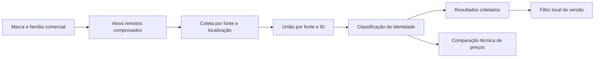

# Catálogo de busca: marcas, modelos e integrações

Documento operacional da revisão de 23/10/2026. O relatório de cobertura e a evidência da execução real ficam ao final. A aquisição nativa e quatro chamadas reais de anúncios já foram concluídas; identidade dos anúncios e publicação são verificações separadas. Uma validação simulada não substitui esses campos.

## Objetivo e invariantes

O critério de busca é a **família comercial de um modelo dentro de uma marca**. Quem seleciona Chevrolet → Celta procura os Celta encontrados no recorte de localização, ano, preço, quilometragem e vendedor escolhido. Quantidade de portas, geração e descrição de versão não criam novas opções de coleta para o usuário.

As garantias são:

- Uma opção por família comercial revisada, sempre subordinada à marca correta.
- Cada filtro enviado a uma fonte precisa de um contrato daquela fonte. Um nome encontrado em um anúncio não comprova que esse nome é aceito como filtro remoto.
- Uma família pode corresponder a vários modelos nativos de uma fonte. A coleta executa todos os alvos conhecidos e une os anúncios por fonte/identificador.
- Versão e configuração não restringem requisições de coleta. Versão é um filtro local dos resultados recebidos.
- Agrupar modelos para busca não torna versões, motores, câmbios ou preços equivalentes.
- Correspondências ausentes, conflitantes ou ambíguas continuam explícitas. Não se inventam IDs externos nem se confirma identidade por aproximação de texto.
- Abrir a tela, escolher marca/modelo, trocar a versão dos resultados e salvar critérios não consultam anúncios nos fornecedores.

“Completo” significa incorporar integralmente o catálogo nativo adquirido e informar sua origem, data, cobertura e pendências. Não significa conhecer todo veículo produzido, garantir um catálogo estruturado OLX que a integração não oferece, ou coletar todos os anúncios existentes em uma consulta.

Os seletores exibem somente marcas e famílias que possuem alvos do catálogo nativo de busca. Entidades técnicas sem alvo permanecem internamente para histórico e classificação; não são anunciadas no dropdown como opções remotas comprovadas. A API de opções rejeita pedidos de `versions` e `configurations`, porque esses campos não fazem parte dos critérios de coleta.

## Três relações diferentes

| Relação                   | O que representa                                                                                   | Pode autorizar um filtro remoto?                     |
| ------------------------- | -------------------------------------------------------------------------------------------------- | ---------------------------------------------------- |
| Marca/modelo canônico     | Identidade comercial apresentada na busca                                                          | Apenas depois de resolver os alvos da fonte          |
| `queryTargets`            | Marca/modelo nativos aceitos no contrato de busca, vinculados à família canônica e a uma evidência | Sim, para aquela fonte e aquele contrato             |
| `references` / `mappings` | Identidade, aliases e observações de anúncios retornados                                           | Não, isoladamente; servem à classificação de entrada |

A seta de classificação para comparação técnica não passa pelo agrupamento visual de versões. O filtro local seleciona linhas; não altera a identidade técnica dessas linhas.

### Famílias e aliases revisados

`src/data/commercial-models.json`, `src/lib/commercial-names.ts` e `src/lib/commercial-models.ts` definem a projeção comercial. As regras são explícitas e consideram a marca. O catálogo técnico continua disponível para relacionar versões; registros legados são projetados sem reescrever observações históricas.

Exemplos de intenção:

- Celta 2P e Celta 4P pertencem à busca Celta.
- Camaro e um registro técnico identificado como Camaro (2017) pertencem à busca Camaro.
- A3, A3 Sedan, A3 Cabriolet, A3 Sportback e o alias revisado A3 Spotback pertencem à família A3.
- **S3 e RS3 não pertencem à família A3.**
- **Onix e Onix Plus permanecem famílias diferentes.**
- **Ka e Ka+ permanecem famílias diferentes.** O sinal `+` não pode desaparecer durante a comparação de nomes.

O snapshot nativo possui `KA` e `KA +`. `modelLabelKey` remove diferenças cosméticas de espaços, mas preserva `+`; assim `KA +` pode corresponder ao alias revisado `KA+`, mantendo-se distinto de `KA`. O nome nativo enviado à fonte continua `KA +`. A ausência de um alvo nativo separado para uma família técnica, como Onix Plus neste snapshot, não autoriza vinculá-la automaticamente ao alvo ONIX.

Não existe uma regra genérica “remover tudo depois da primeira palavra” ou “aceitar qualquer nome que comece com o modelo”. Um novo agrupamento exige evidência, decisão explícita e casos negativos. A ausência de versão técnica para um modelo nativo novo não impede oferecê-lo como critério de busca; impede afirmar uma versão técnica ainda não comprovada.

### Identificadores e evidências

Um `queryTarget` registra `source`, `canonicalBrandId`, `canonicalModelId`, `sourceBrand`, `sourceModel`, `evidenceId` e `status: confirmed`. `sourceBrandId` e `sourceModelId` só são preenchidos quando realmente fornecidos pela origem.

IDs internos estáveis gerados para registros novos têm namespace interno. Não são IDs Webmotors/OLX e não são enviados como se fossem. Quando o contrato remoto usa nomes, a requisição usa os nomes nativos preservados pelo alvo, mesmo que a interface apresente uma família mais curta.

A evidência registra URL, data de obtenção, tipo e SHA-256. O hash deve indicar exatamente qual artefato foi resumido. O executor de operações calcula o hash da resposta **sanitizada**, não dos bytes HTTP originais; esses hashes não devem ser apresentados como se fossem intercambiáveis.

O validador rejeita, entre outros erros: evidência inexistente, modelo sem marca, versão sem modelo, alvo apontando para uma combinação canônica inválida, IDs duplicados e um alvo nativo associado de forma ambígua. Normalizar grafia não elimina a necessidade de validar essas relações.

## Contratos das integrações

| Integração         | Descoberta de critérios                                                                      | Coleta                                                              | Limite de interpretação                                                                      |
| ------------------ | -------------------------------------------------------------------------------------------- | ------------------------------------------------------------------- | -------------------------------------------------------------------------------------------- |
| Webmotors via Reef | `POST /webmotors/v1/makes_models`, com `vehicle_type: car`                                   | `POST /webmotors/v1/search`, com `make` e `model` nativos           | Uma observação de anúncio não substitui o catálogo de critérios aceitos                      |
| OLX via Gecko      | A integração usada não fornece um contrato independente de catálogo completo de marca/modelo | `POST /v1/extract`, `target: olx.com.br`, `type: plp`, URL de busca | Marca/modelo são texto de busca; a consulta não confirma a identidade de todos os resultados |

Referências: [documentação Reef Webmotors](https://reefapi.com/docs/webmotors), contratos e testes em `src/lib/source-query.ts`, `src/lib/discovery-providers.ts` e `tests/source-query.test.ts`.

### Webmotors: vínculo 1:N

`planSourceQuery` resolve a seleção canônica e retorna `queries`, com todos os alvos Webmotors confirmados para aquela família. O campo de compatibilidade `query` contém somente o primeiro; executores devem usar **`queries`**, para não perder os demais.

Uma família com três modelos nativos e duas cidades pode exigir seis consultas. Consultas são deduplicadas pelo par de nomes nativos antes de executar, e anúncios repetidos entre consultas são unidos por fonte/ID. O total de inventário de recortes sobrepostos não é somado como se fosse um conjunto disjunto.

Entrada manual só é traduzida quando corresponde de forma inequívoca a uma família ou a um nome nativo conhecido. Sem alvo comprovado, ou com mais de uma família candidata, essa fonte não é chamada: o resultado informa a pendência. Nenhum crédito de coleta deve ser reservado para “testar” automaticamente um nome incerto.

O payload de coleta pode manter os filtros já suportados de localização, ano, preço, quilometragem e vendedor. **Não contém `trim`, versão, portas, configuração ou IDs técnicos internos.**

### OLX: texto não é identidade

A URL é montada a partir de marca/modelo canônicos e localização, com os parâmetros de busca suportados. O plano registra correspondência de consulta `uncertain`: resultados de uma busca textual podem incluir modelos diferentes, anúncios relacionados ou descrições incompletas.

A classificação posterior usa os campos realmente recebidos, os IDs existentes e os vínculos de entrada comprovados. A consulta textual, sozinha, nunca transforma um anúncio em correspondência confirmada. Anúncios incertos e incompatíveis continuam separados e inspecionáveis.

IDs de outros produtos OLX, como um catálogo de publicação de anúncios, não são presumidos como filtros Gecko. Uma futura integração estruturada precisa do seu próprio contrato e validação antes de criar `queryTargets` OLX.

## Versão somente nos resultados

O formulário de coleta contém marca/modelo e os demais critérios comerciais existentes. Não possui campo Configuração nem seletor de versão para o fornecedor. A área dos resultados apresenta **Versão nos resultados**.

`src/lib/result-facets.ts` calcula as opções a partir de todos os anúncios da execução carregada (`currentRows`), antes de aplicar esse filtro e de dividir a exibição em confirmados, incertos ou incompatíveis. O filtro não usa apenas os primeiros cartões visíveis.

- **Todas as versões** mantém todos os anúncios coletados nessa execução.
- Cada opção informa a quantidade de anúncios daquele grupo; repetições do mesmo ID na mesma fonte contam uma vez.
- **Não informada** aparece quando há registros sem versão identificável. Não se deduz versão a partir do título.
- A versão explicitamente recebida da origem tem prioridade. Diferenças cosméticas de caixa, espaços e espaços em torno de hífens podem compartilhar uma opção.
- Motor, transmissão, números significativos e termos como conversível não são removidos. `A-8` e `A-10`, por exemplo, permanecem diferentes.
- Uma descrição completa OLX usada para refinar os resultados é identificada como **descrição OLX**, separada de uma versão explicitamente recebida. Ela não vira, por esse motivo, uma equivalência técnica com Webmotors.
- Grupos pertencentes a famílias diferentes não se misturam só porque sua versão possui a mesma grafia.

O estado é local e temporário, associado à execução carregada. Outra busca/execução volta para Todas as versões. A troca não faz HTTP, não reserva crédito, não cria `SearchRun`, não salva um novo critério e não modifica dados de anúncios.

Os links internos de `ListingCard` usam `prefetch={false}`. Isso evita que a aparição de um cartão após a troca de versão provoque carregamento antecipado da página de detalhes. A navegação continua disponível ao clicar no anúncio ou em Conferir semelhantes.

Os números do seletor representam os **anúncios recebidos**, inclusive os classificados como incertos ou incompatíveis. A quantidade de cartões confirmados pode ser menor que a contagem da opção. O filtro de versão não promove um anúncio incerto a confirmado.

## Cobertura, paginação e custo

Há três coberturas diferentes, que precisam ser medidas separadamente:

1. **Catálogo nativo:** todas as marcas/modelos da resposta adquirida foram lidas, validadas e representadas, sem recorte por uma lista de marcas populares.
2. **Vínculo de busca:** cada alvo nativo foi associado a exatamente uma família; entidades técnicas sem alvo remoto permanecem identificáveis como pendentes para aquela fonte.
3. **Anúncios:** quantas páginas e recortes realmente foram consultados, quantos anúncios chegaram, quantos foram normalizados e quantos atendem aos critérios.

A coleta atual executa **uma página por alvo e localização**. Webmotors solicita `page: 1` e `page_size: 24`; OLX recebe a primeira página e observa `nextPageUrl`, sem percorrê-la automaticamente. A normalização limita o processamento de uma resposta a 100 registros e registra excedentes/descartes.

`partial`, `received`, `total`, `normalizationDiscards` e `targets` descrevem a execução. `targets` mantém marca/modelo nativos, localização, status, cobertura, registros e créditos de cada consulta. Se algum alvo falha, os demais resultados continuam disponíveis e a união é parcial. Na união de vários recortes, o total único não é inventado a partir da soma de totais possivelmente sobrepostos.

“Todos os Celta” significa **não restringir a coleta a uma versão ou configuração**. Não é uma promessa de varrer todo o inventário do portal. O filtro local só alcança versões presentes nas páginas recebidas. Resultado vazio também não prova ausência daquele veículo no portal nem invalida sozinho o catálogo de critérios.

Cada alvo/página/cidade adicional pode adicionar consumo. As reservas são sequenciais e preservam o limite diário/plano existente. Resolver uma cidade OLX ainda desconhecida pode exigir um crédito Reef adicional; isso pertence ao fluxo normal de localização, não ao lote fechado de validação descrito abaixo.

## Critérios legados, histórico e cache

`src/lib/search-criteria.ts` define `collectionCriteria`: remove `version`, `doors`, `versionCode`, `versionName`, `configurationCode` e `configurationName`, e limpa `olxUrl`. Uma URL legada pode carregar um filtro oculto de versão/portas; por isso não é reaproveitada para a nova coleta.

O servidor aplica essa separação mesmo que um cliente antigo ainda envie esses campos. O frontend também deixa de enviar IDs de versão/configuração. Ter o mesmo tratamento nos dois lados evita depender de um formulário atualizado para garantir o contrato.

Aliases legados de modelo são resolvidos para a família atual. Uma busca antiga pode ser restaurada como Celta mesmo tendo sido salva como Celta 2P. A resposta inclui `criteriaMigrationNotice` quando o critério precisou dessa adaptação:

> Esta busca agora coleta todo o modelo. Resultados antigos mantêm o recorte da coleta original; execute novamente para ampliar. Refine a versão nos resultados.

Isso não amplia retroativamente uma coleta antiga. As observações, IDs, datas, preços e falhas históricas são preservados. O catálogo atual pode reclassificar sua identidade na leitura; não pode inventar anúncios que a requisição original deixou de receber.

O cache de coleta inclui a versão do contrato de coleta e as revisões técnica, comercial e nativa de busca. Uma mudança nos alvos remotos não pode reutilizar silenciosamente o resultado de uma revisão diferente. Respostas reutilizadas informam crédito reservado zero; a atualização do catálogo por si só não dispara uma nova coleta paga.

## Desempenho e disponibilidade

As consultas locais de opções devem continuar independentes dos fornecedores. A leitura do catálogo compartilha uma promessa entre chamadas simultâneas, verifica a revisão ativa em intervalos de 30 segundos e reaproveita o snapshot validado. Uma falha transitória de leitura conserva o catálogo válido anterior quando disponível.

`catalog-store` importa o snapshot nativo versionado em `src/data/search-catalog.json` e o projeta sobre o catálogo técnico ativo. A leitura normal de opções não consulta `ProviderOperation`, não baixa novamente o snapshot e não paga por um cache miss. Uma nova aquisição precisa ser importada, revisada e publicada como dado versionado antes de mudar as opções do produto.

Índices de identidade são construídos uma vez por snapshot imutável, com `WeakMap`; a resposta de buscas salvas compartilha contexto de enriquecimento. Não adicionar varreduras completas aninhadas de marca/modelo/versão para cada anúncio ou cada busca salva. O filtro de versão usa mapas em uma passagem pelos anúncios coletados, sem resolver novamente a identidade técnica.

Em uma mudança de catálogo, validar também a latência de carregar buscas salvas, histórico e seletores. O fato de um teste de equivalência passar não comprova que a aplicação continua responsiva com o catálogo completo.

## Aquisição e validação real com orçamento fechado

O lote `search-catalog-20261023` admite no máximo **5 créditos Reef e 2 créditos Gecko**, distribuídos em até cinco operações:

| Operação permitida | Limite por operação | Contrato fixo                                                      |
| ------------------ | ------------------- | ------------------------------------------------------------------ |
| Catálogo Reef      | 1 crédito           | `makes_models`, somente `vehicle_type: car`                        |
| Validação Reef     | 2 créditos          | `search`, marca/modelo, página 1, tamanho 10, localização opcional |
| Validação Gecko    | 1 crédito           | Extração OLX PLP em URL validada, primeira página                  |

Essa distribuição permite uma aquisição de catálogo, duas validações Reef e duas Gecko. É um **teto autorizado**, não uma declaração de consumo já realizado nem uma autorização recorrente para cada deploy.

### Registro e execução no máximo uma vez

`ProviderOperation` persiste `id`, `batchId`, `kind`, `provider`, `status`, `credits`, `request`, `response`, `summary`, `error`, `createdAt` e `completedAt`. A existência de uma operação `queued` no lote permitido é o opt-in; telas e seletores não criam essas operações.

`scripts/provider-operations.mjs` e `scripts/run-approved-provider-operations.mjs` implementam:

1. Transação PostgreSQL com lock consultivo específico do lote e bloqueio das suas linhas.
2. Validação do orçamento de **todo** o lote, incluindo operações `queued`, `running`, `succeeded` e `failed`. Falha não libera nova autorização.
3. Validação de forma da requisição, fornecedor, endpoint, custo e presença da credencial. Uma operação inválida falha sem chamada externa.
4. Transição condicional `queued → running` e registro de `ProviderSpend` na mesma transação.
5. Commit da reserva **antes** da chamada externa.
6. Uma tentativa HTTP; em seguida gravação de `succeeded` ou `failed` com resposta/erro sanitizados. Não há retry automático.

O resultado é **at-most-once**, não exactly-once. Se o processo cair depois da reserva, a operação pode permanecer `running` sem confirmação do resultado. O próximo startup não a executa de novo. Não redefinir seu status para `queued`, apagar a reserva nem criar IDs substitutos para contornar o teto. Primeiro conciliar o ledger e o fornecedor; uma nova tentativa exige uma nova decisão explícita de orçamento e uma operação controlada.

O runner está associado a `npm run db:migrate`, depois de `scripts/verify-database.mjs`. O fluxo de implantação que chama esse comando pode executar operações pendentes. Em SQLite/local, o runner não chama fornecedores. Sem fila pendente não há chamada paga; reiniciar a aplicação não renova o lote. A configuração efetiva do serviço deve manter essa etapa, caso o comando de início seja customizado fora do repositório.

Falhas do runner são capturadas para que o servidor possa subir. As operações são sequenciais e podem aumentar o tempo do startup que efetivamente processar uma fila; há timeout de 45 segundos por requisição, limites de conexão/consulta ao banco e até cinco operações. Não transformar essa etapa em uma varredura recorrente ou sem limite.

### Escopo dos dados e das credenciais

Credenciais são lidas do ambiente já configurado no servidor. Não são copiadas para o navegador, banco de evidências, repositório ou logs.

As operações usam endpoints fixos; o JSON persistido não escolhe um host arbitrário. URLs de validação OLX precisam passar pela lista de hosts, categoria, estado e parâmetros permitidos. Redirecionamentos são rejeitados; cada resposta tem limite de 5 MiB.

O snapshot de catálogo preserva sua estrutura e remove campos sensíveis. A validação de anúncios armazena apenas contagem, total declarado e até 100 registros com identificação pública, marca/modelo/versão e IDs de origem presentes. Não registra contatos do vendedor, cookies, tokens ou o payload integral do anúncio. Logs usam mensagens e códigos conhecidos, sem imprimir credenciais, connection strings ou respostas arbitrárias.

## Atualização do catálogo

Procedimento para uma atualização revisável:

1. Definir fonte, escopo, orçamento e contrato aceito antes de adquirir dados. Não usar navegação por marca/modelo na UI como gatilho de aquisição.
2. Adquirir uma vez o catálogo nativo, persistindo data, resposta sanitizada, hash e resultado da operação. Reutilizar esse artefato para todos os testes e transformações locais.
3. Validar o envelope e percorrer a árvore inteira. Rejeitar nomes vazios, estruturas inesperadas, IDs conflitantes e associações ambíguas; registrar duplicatas equivalentes sem descartes silenciosos.
4. Gerar o snapshot de busca e fazer o merge com as famílias revisadas. Acrescentar modelos nativos ausentes do catálogo técnico com identidade interna estável; não fabricar versões técnicas.
5. Publicar `queryTargets` somente para contratos comprovados. A atualização substitui os alvos dessa fonte; observações de entrada continuam sendo evidências separadas.
6. Produzir o relatório de contagens, cobertura, pendências e diferenças em relação à revisão anterior. Uma redução inesperada exige revisão do artefato/contrato, não preenchimento por suposição.
7. Rodar validações de integridade, negativos, payloads, legado, cache e navegador. Usar somente a amostra paga já delimitada para validar a integração real.
8. Publicar código/dados e revisão coerentes. Registrar commit e deploy, verificar saúde, opções e buscas salvas. Conservar a revisão válida anterior como referência para diagnóstico.

O snapshot normalizado de busca fica em `src/data/search-catalog.json` e o merge em `mergeSearchCatalog`. `scripts/import-search-catalog.mjs` trabalha offline sobre a operação já concluída: verifica status, hash/tamanho, envelope, `stop_reason: complete`, contagens declaradas e registros de cada marca. Preserva a resposta sanitizada em `src/data/evidence/` e grava o snapshot normalizado; não solicita credenciais nem faz HTTP. A chamada é `node scripts/import-search-catalog.mjs caminho/operacao.json diretorio-de-saida`; a saída padrão é `src/data`.

O script anterior `scripts/prepare-source-catalog.mjs` documenta a requisição de aquisição e, por padrão, só imprime o plano; seu modo `--execute` é uma chamada separada e **não deve ser executado junto do lote persistido**, para não duplicar aquisição/consumo. Nesta revisão, a aquisição autorizada usa `ProviderOperation`. O catálogo técnico possui seu procedimento próprio de importação em `scripts/import-vehicle-catalog.mjs`. Uma importação técnica não deve ser confundida com prova dos nomes aceitos nas APIs de busca.

## Matriz mínima de validação

| Camada               | Evidência necessária                                                                                                  |
| -------------------- | --------------------------------------------------------------------------------------------------------------------- |
| Integridade          | Todos os registros nativos representados; pais válidos; IDs/evidências consistentes; sem alvos ambíguos               |
| Famílias             | Celta/Camaro/A3 sem opções redundantes; S3, RS3, Onix Plus e Ka+ não incorporados indevidamente                       |
| Plano remoto         | Todos os alvos 1:N; nomes nativos; bloqueio de seleção inválida; nenhum `trim`, versão, portas ou configuração        |
| Resposta             | IDs/nome original preservados; união por fonte/ID; falha parcial identificada; vazio não usado como prova de ausência |
| Facet de versão      | Todas as linhas da execução; contagens; desconhecidos; descrição OLX identificada; diferenças técnicas preservadas    |
| Navegador            | Troca de versão sem HTTP e sem alteração em `ProviderSpend`/`SearchRun`; desktop e mobile; legado e payload salvo     |
| Histórico/cache      | Antigos recortes preservados; aviso de migração; revisão de alvos invalida reaproveitamento indevido                  |
| Custo/concorrência   | Claim único; reserva antes da chamada; limite total incluindo falhas; nenhum retry em novo startup                    |
| Comparação de preços | Família comum não relaxa versão técnica, motorização, transmissão ou demais critérios de comparabilidade              |
| Produção             | Requisições delimitadas reais, latência e saúde verificadas, sem atribuir aos testes locais a validação do fornecedor |

Testes relevantes: `tests/native-search-catalog.test.ts`, `tests/source-query.test.ts`, `tests/commercial-models.test.ts`, `tests/result-facets.test.ts`, `tests/provider-operations.test.ts`, testes de store/cache e `scripts/browser_commercial_models.py`. O roteiro de navegador usa SQLite isolado, bloqueia requisições de coleta e verifica a ausência de consumo; não valida disponibilidade externa.

## Relatório da revisão e validação real

As contagens abaixo vêm do snapshot real e da [auditoria completa da junção](search-catalog-20261023-audit.md), com [relatório estruturado](search-catalog-20261023-audit.json). A base técnica é contabilizada separadamente; fixtures não participam dos totais.

| Campo                                                      | Resultado                                                                                                                                                                                                                 |
| ---------------------------------------------------------- | ------------------------------------------------------------------------------------------------------------------------------------------------------------------------------------------------------------------------- |
| Data/hora e revisão da aquisição                           | `2026-10-23T17:43:47.415Z`; `reef-makes-models-20261023-9f011baae24c7304`                                                                                                                                                 |
| URL, hash e artefato sanitizado                            | `https://api.reefapi.com/webmotors/v1/makes_models`; SHA-256 `9f011baae24c7304c1e74a183c517403db522be81a121975b229b2770da45390`; `src/data/evidence/reef-makes-models-20261023.json`, 17.953 bytes                        |
| Marcas e modelos nativos recebidos                         | **136 marcas e 1.261 modelos nativos**; contagens declaradas conferidas; `stop_reason: complete`; uma requisição upstream declarada                                                                                       |
| Marcas e famílias canônicas resultantes                    | **135 marcas e 1.255 modelos comerciais oferecidos no seletor**; 140 marcas e 1.512 modelos no catálogo interno após a junção                                                                                             |
| Alvos Webmotors confirmados e famílias com mais de um alvo | **1.261 alvos**, cobrindo todas as folhas nativas; seis famílias com dois alvos preservados                                                                                                                               |
| Duplicatas/ambiguidade do seletor                          | **Zero grupos de rótulos normalizados duplicados**; integridade e conservação das folhas verificadas pela auditoria offline                                                                                               |
| Famílias sem alvo Webmotors e limites OLX                  | **257 famílias técnicas somente internas**, sem alvo aprovado para os seletores; OLX textual permanece explicitamente incerta                                                                                             |
| Validações pagas                                           | Quatro operações `succeeded`, zero falhas; **100 registros recebidos** nas quatro respostas, detalhados abaixo                                                                                                            |
| Créditos do lote, incluindo aquisição                      | **5 Reef e 2 Gecko**, dentro do teto; cinco operações concluídas, nenhuma interrompida ou repetida                                                                                                                        |
| Verificação automatizada da entrega                        | **305 testes aprovados**, lint e build de produção concluídos                                                                                                                                                             |
| Teste de navegador                                         | **Aprovado em 23/10/2026, 18:04:18 UTC**, viewports 1.440 e 390 px; troca de versão com zero HTTP, zero tentativas de fornecedor, sem consumo, overflow ou erros JavaScript; `test-results/commercial-models/report.json` |
| Commit, deploy e verificação de saúde                      | Pendente da publicação e verificação final da entrega                                                                                                                                                                     |

O snapshot retornou nomes nativos, **sem IDs de marca/modelo**. Os vínculos desta aquisição usam os nomes aceitos no contrato, e nenhum ID externo foi fabricado. O fornecedor declarou um crédito Reef na aquisição; os demais quatro créditos Reef e dois Gecko pertencem às quatro validações. Os 17.953 bytes acima são do artefato sanitizado preservado; não representam o tamanho de transporte informado pelo fornecedor.

### Amostra real das integrações

As operações abaixo pertencem ao lote `search-catalog-20261023`, usam Chevrolet e o estado PR, sem versão/configuração/portas no filtro. Os horários são UTC em 23/10/2026.

| Operação                  | Critério remoto                                                          | Conclusão                 | Recebidos / total declarado | Créditos |
| ------------------------- | ------------------------------------------------------------------------ | ------------------------- | --------------------------- | -------: |
| `validation:gecko:camaro` | Texto `CHEVROLET Camaro`, categoria de automóveis, PR                    | `succeeded`, 17:56:32.530 | 30 / 30                     |  1 Gecko |
| `validation:gecko:celta`  | Texto `CHEVROLET CELTA`, categoria de automóveis, PR                     | `succeeded`, 17:56:34.233 | 50 / 215                    |  1 Gecko |
| `validation:reef:camaro`  | `make: CHEVROLET`, `model: CAMARO`, `location: pr`, página 1, tamanho 10 | `succeeded`, 17:56:46.105 | 10 / 25                     |   2 Reef |
| `validation:reef:celta`   | `make: CHEVROLET`, `model: CELTA`, `location: pr`, página 1, tamanho 10  | `succeeded`, 17:56:48.298 | 10 / 76                     |   2 Reef |

Essa amostra comprova que os quatro pedidos foram aceitos e retornaram anúncios. Os 100 registros são a soma de itens recebidos, **não um inventário único entre portais nem 100 identidades confirmadas**. A auditoria de correspondência de entrada é separada do sucesso HTTP e deve registrar confirmados/incertos/incompatíveis sem promover descrições livres por prefixo.

A cobertura de anúncios é parcial: as duas buscas Reef e Celta/OLX retornaram menos itens que seus totais declarados. Camaro/OLX retornou a quantidade declarada naquela resposta, o que não prova cobertura de outros recortes nem permanência desse total. Nenhuma página adicional foi consultada para aumentar a amostra, e não houve repetição automática das chamadas.

Uma operação HTTP bem-sucedida comprova execução daquele contrato e amostra; não comprova, isoladamente, cobertura completa de anúncios ou identidade de toda versão retornada.

## Replay da identidade nas respostas reais

As quatro respostas sanitizadas estão em `tests/fixtures/real-provider-model-validation.json`; o [relatório de identidade](search-catalog-20261023-inbound.json) registra o antes/depois, hashes e resultados por operação. Na amostra OLX, 48 dos 80 anúncios tinham descrições ainda não vinculadas. Foram revisadas **11 descrições literais** (quatro de Camaro e sete de Celta), com marca, URL, hash e operação de origem, para identificar somente a família. Não se usa corte genérico de prefixo e esses vínculos não autorizam filtros outbound.

Após essa revisão, **100/100 registros da amostra identificam a família solicitada**, tanto na projeção técnica completa quanto no fallback do catálogo nativo. A identidade técnica da versão permanece não resolvida nos 100 registros: a interface preserva a versão/descrição original, sem fabricar equivalência técnica nem rejeitar o modelo correto. Isso comprova a amostra revisada; uma descrição OLX nova ainda pode ficar incerta. O teste de replay executa offline e verifica também que a faceta de versão não modifica o plano da API.

O ledger `ProviderSpend` foi conciliado após as cinco operações: **3 operações Reef, 5 créditos; 2 operações Gecko, 2 créditos**. Todas as cinco `ProviderOperation` terminaram em `succeeded`; não restou operação pendente, falha ou nova tentativa. Nenhuma página adicional foi coletada.

## Verificação de desempenho antes da publicação

Em 23/10/2026, o build de produção foi exercitado com o catálogo técnico completo (63 marcas, 1.113 modelos e 6.112 versões), o snapshot nativo, 30 buscas legadas manuais e 232 anúncios persistidos. Foram 46 requisições locais, com até seis concorrentes, incluindo `/`, `/api/searches` e opções: todas HTTP 200. A página de saúde `/` levou no máximo **561,1 ms** no início; o maior tempo nas 40 requisições após aquecimento foi **126,2 ms**. Nenhum fornecedor foi consultado. Esse teste controla regressões locais; não representa latência garantida do plano Render.

O `WeakMap` do planejador compartilha índices de IDs, famílias e rótulos, inclusive entre buscas manuais antigas. O carregamento do catálogo continua com single-flight e revisão a cada 30 segundos; a resolução não reconstrói as 6.112 versões por anúncio. O teste de complexidade verifica acessos aos índices, evitando depender só de medições de tempo.
